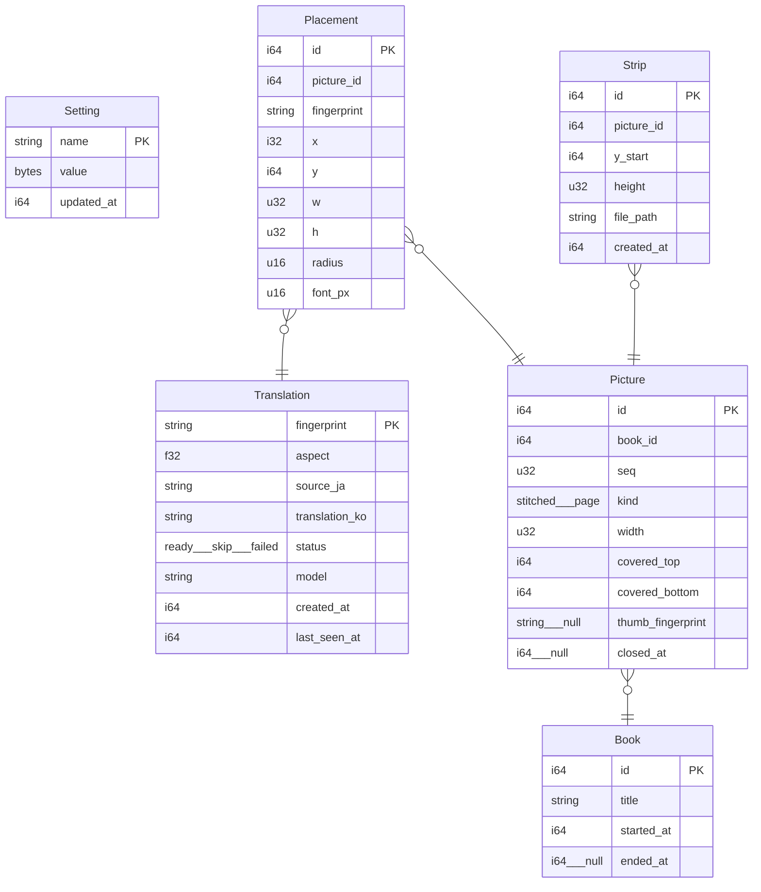
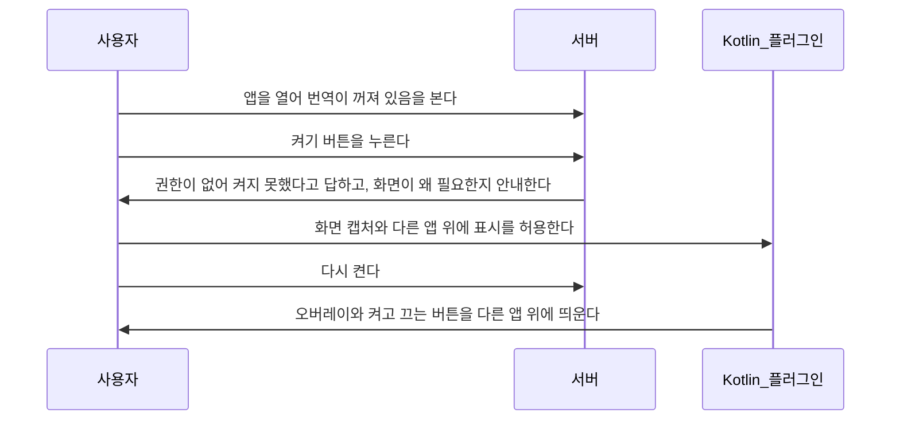
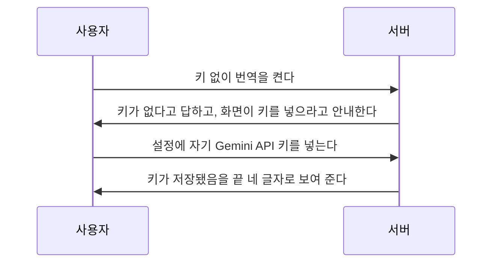
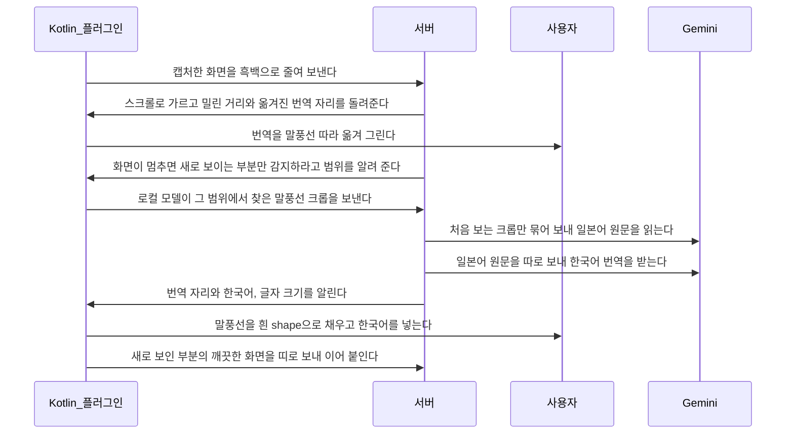
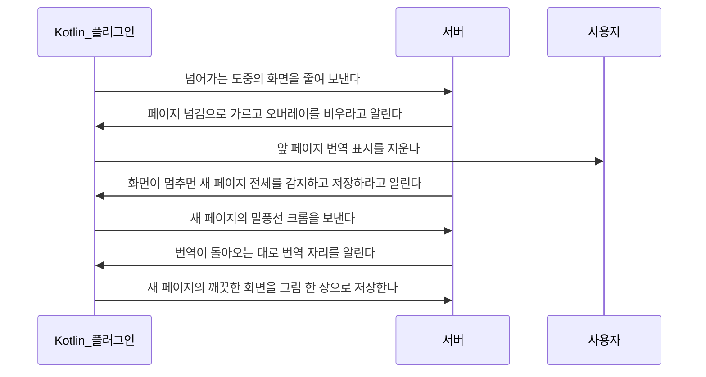
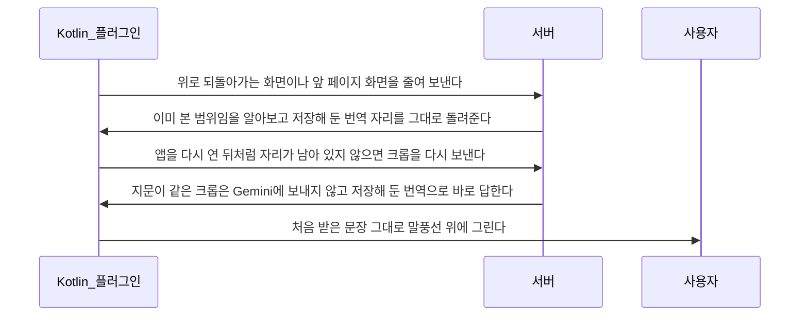
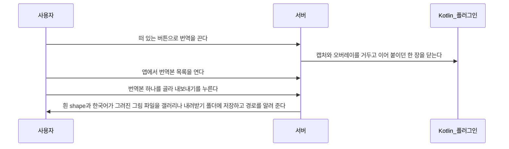

# 백엔드 설계 — realtime-screen-translator

> 나는 다음을 만들고 싶어.
- 실시간 화면 인식 번역 프로그램.
스크롤및 앞뒤로 왔다갔다 할 때를 트래킹을 해야하고, 이미 했던 번역을 또하는것은 피해야해.
또한 효과음 번역도 피해야해.
대표적인 용도는 일본 만화를 한국어로 실시간 번역 하는것이야.
이때, 모바일에서의 최적화가 가장 중요해.(기준 기기는 갤럭시 s21)

번역 모델은 gemini 3.1 flast lite.
이떄 기본적으로 있는 gemini의 안전 가드레일은 off로.(거기에 더해 프리필까지.)

중요한것은 다음과 같아.
- 화면 위 아래 스크롤과 앞뒤로 슬라이딩으로 이전/다음 페이지를 넘기는 방식을 구분할것.
- 화면 위 아래 스크롤 방식에서, 어떻게 트래킹 할것인가?
- 번역하는 화면에서, 어떻게 "이미 했던 번역"임은 어떻게 알것인가?

화면을 실시간으로 인식해 번역하는 프로그램을 모바일과 PC 둘 다에서 쓸 수 있게 웹 브라우저에서 돌아가는 형태로 만듭니다. 가장 많이 쓰는 쪽은 모바일이라 갤럭시 S21을 기준 기기로 삼아 모바일 최적화를 가장 우선합니다. 대표 용도는 일본 만화를 한국어로 실시간 번역하는 일이며, 위아래 스크롤과 앞뒤 슬라이딩으로 이전/다음 페이지를 넘기는 방식을 구분해 트래킹하고, 이미 했던 번역과 효과음은 번역하지 않습니다. 번역 모델은 Gemini 3.1 Flash Lite이고, 기본 안전 가드레일은 끄고 프리필까지 넣습니다.

## 스택

요구 대화에서 고른 것이다. 바꾸려면 새 실행을 시작한다.

| 부분 | 고른 것 | 이유 |
| --- | --- | --- |
| 백엔드 | Rust + Tauri 2 (cargo), Android용 Kotlin 플러그인이 화면 캡처·말풍선 감지·오버레이를 모두 맡음 (ONNX Runtime Android) | 고르신 묶음입니다. Android에서는 Kotlin 플러그인이 캡처한 그림을 Rust로 넘기지 않고 그 자리에서 감지해 오버레이에 그립니다. Gemini 요청과 이미 했던 번역 찾기는 Rust에 두어 갤럭시와 Windows가 함께 쓰고, Windows의 캡처·감지·오버레이는 Rust로 따로 짭니다. |
| 프런트엔드 | Svelte + Vite (pnpm) | 켜고 끄는 화면과 설정, 번역본 목록만 그리면 되어 코드가 작은 틀이 맞고, 갤럭시 S21에서 앱이 빨리 뜹니다. |
| 스타일 | Tailwind CSS | 휴대폰과 PC 화면 크기별 모양을 한자리에서 적고, 쓰지 않는 스타일은 빌드할 때 빠집니다. |
| 데이터 저장 | 기기 안 SQLite + 앱 전용 폴더의 그림 파일 | 서버가 없으니 이미 했던 번역은 지문으로 바로 찾도록 SQLite에 두고, 번역본 그림은 파일로 둡니다. Gemini API 키도 기기 안에만 둡니다. |
| 테스트 | cargo-nextest + Vitest (둘 다 JUnit XML 보고서) | Rust 쪽 계약 테스트는 cargo-nextest로, 화면 테스트는 Vitest로 돌려 둘 다 JUnit XML을 GitHub Actions에 넘깁니다. Kotlin 플러그인이 맡는 캡처와 감지, 오버레이는 실제 갤럭시 S21에서 따로 확인해야 합니다. |
| 배포 | GitHub Actions가 Android APK와 Windows 설치 파일을 만들어 GitHub Releases에 올림 | 설치하는 앱이라 운영할 서버가 없고, 갤럭시에서는 APK를 내려받아 설치합니다. 앱 장터 등록은 첫 버전에서 다루지 않습니다. |

## 에이전트가 정한 가정

- A1 설계서의 API는 HTTP 서버가 아니라 Tauri 명령으로 짓는다. 경로는 명령 이름으로 옮겨 부르는데, 이를테면 `POST /frames`는 `post_frames` 명령이 된다. 번역이 늦게 돌아올 때는 Tauri 이벤트로 알린다. — 이유: 스택이 Rust + Tauri 2로 정해졌고 Kotlin 플러그인과 Svelte 화면이 모두 같은 프로세스 안에서 Rust를 부른다. 포트를 여는 서버를 따로 두면 배터리와 보안 부담만 는다. / 버린 안: 기기 안에 localhost HTTP 서버를 띄우는 방식. 다른 앱이 그 포트로 요청을 보내 남의 Gemini API 키를 쓸 길이 생긴다.
- A2 스크롤과 슬라이딩 구분, 밀린 거리 계산은 Rust가 맡는다. Kotlin 플러그인은 캡처한 화면을 가로 96px 흑백으로 줄여 보내고, Rust는 앞 그림과 세로로 맞춰 보아 가장 잘 겹치는 거리를 찾는다. 잘 겹치면 스크롤, 어느 거리에서도 겹치지 않은 뒤 두 프레임이 같아지면 페이지 넘김으로 본다. 스크롤해도 움직이지 않는 위아래 띠는 고정된 부분으로 표시하고, 감지는 화면이 멈췄을 때만 시킨다. — 이유: 판정 규칙이 한곳에 있어야 Android와 Windows가 같은 결과를 내고, cargo-nextest에 그림 묶음을 넣어 검증할 수 있다. 줄인 그림은 수십 킬로바이트라 기준 기기에서 프레임마다 넘겨도 부담이 작다. / 버린 안: 접근성 서비스로 스크롤 이벤트를 받는 방식은 앱마다 값이 다르고 스토어 심사가 까다롭다. 터치 방향으로 가르는 방식은 오버레이가 터치를 가로채야 해서 R7과 부딪친다.
- A3 지문은 크롭을 9×8 흑백으로 줄여 이웃 칸의 밝기 차이로 뽑은 64비트 값이고, Rust가 계산한다. 저장된 지문과 6비트 이하로 다르고 가로세로 비율 차이가 10% 안이면 같은 말풍선으로 본다. — 이유: 같은 말풍선이라도 스크롤 위치와 화면 배율에 따라 크롭 테두리가 몇 픽셀씩 달라지므로, 완전히 같은 값만 찾으면 이미 했던 번역을 놓친다. 지문은 Gemini에 보내기 전에 기기 안에서 나오므로 요청 횟수를 늘리지 않는다. / 버린 안: 일본어 원문 글자로 견주는 방식은 원문을 읽으려고 Gemini 요청을 먼저 보내야 한다. 크롭 파일의 바이트를 그대로 견주는 방식은 한 픽셀만 달라도 어긋난다.
- A4 로컬 모델은 글자 자리를 말풍선 안과 말풍선 밖 두 갈래로 내놓고, 말풍선 밖 글자는 효과음으로 보아 Gemini에 보내지 않는다. 말풍선 안에 효과음만 적힌 경우는 원문 읽기 요청이 빈 값을 돌려주게 하고, 그 지문을 `skip`으로 저장해 다시 묻지 않는다. — 이유: 효과음은 거의 말풍선 밖 그림 위에 그려지므로 자리만 보고도 대부분 걸러진다. 감지 단계에서 Gemini 요청이 나가지 않는다는 R25도 지킨다. / 버린 안: 모든 글자를 Gemini에 보내 효과음인지 묻는 방식. 요청 수가 늘고 효과음이 번역될 위험이 남는다.
- A5 Gemini 요청은 Rust가 `generateContent`로 직접 보낸다. 모델 이름은 `gemini-3.1-flash-lite`를 기본값으로 설정에 둔다. 안전 가드레일은 `safetySettings`의 모든 항목을 `OFF`로 보내 끄고, 모델이 `OFF`를 거절하면 `BLOCK_NONE`으로 다시 보낸다. 프리필은 `contents` 끝에 `model` 차례를 붙여 넣으며 원문 읽기는 `{"ja":["`, 번역은 `{"ko":["`로 시작한다. 한 번 감지에서 나온 크롭은 묶어서 읽기 요청 하나와 번역 요청 하나로 보낸다. — 이유: 묶어 보내면 요청 수와 기다리는 시간이 줄고, 같은 화면의 대사가 함께 가서 번역 말투가 맞는다. JSON 첫머리를 프리필로 주면 모델이 거절 문구 없이 값만 잇는다. / 버린 안: 말풍선마다 따로 요청하는 방식은 한 화면에 요청이 열 번 넘게 나간다. 읽기와 번역을 한 요청에 합치는 방식은 R27이 막는다.
- A6 Android에서는 캡처한 화면에 오버레이가 함께 찍힌다. 그래서 이미 번역 자리가 놓인 곳과 절반 넘게 겹치는 감지는 버리고, 페이지가 넘어가면 오버레이를 먼저 비운 뒤 다음 프레임을 쓴다. 번역본에는 오버레이가 그려지기 전의 깨끗한 화면만 띠 파일로 저장하고, 흰 shape과 한국어는 내보낼 때 그려 넣는다. — 이유: 새로 보이는 부분에는 아직 번역이 그려지지 않았으므로 그 띠는 깨끗하다. 띠로 나눠 두면 이어 붙인 한 장이 아무리 길어도 메모리에 통째로 올리지 않는다. / 버린 안: 번역이 얹힌 화면을 그대로 저장하는 방식은 번역이 늦게 뜬 말풍선이 일본어로 남는다. 오버레이 창을 보안 창으로 표시해 캡처에서 빼는 방식은 그 자리가 검게 찍혀 번역본에 쓸 수 없다.
- A7 Windows에서는 Kotlin 플러그인이 하던 캡처와 감지, 오버레이를 Rust 모듈이 맡아 같은 명령을 부른다. 캡처는 Windows Graphics Capture, 감지는 같은 ONNX 모델, 오버레이는 클릭이 통과하는 투명한 Tauri 창이고 이 창은 캡처에서 뺀다. 권한은 따로 묻지 않는다. — 이유: 판정과 번역 저장을 Rust에 모아 두었으므로 Windows는 캡처와 그리기만 갈아 끼우면 휴대폰과 같은 번역이 나온다. / 버린 안: Windows를 첫 버전에서 빼는 방식. 확인한 재진술이 모바일과 PC 둘 다를 말한다.

## 나중에 되돌리기 어려운 것

- 저장 키: `Setting.name`, `Translation.fingerprint`, `Book.id`, `Picture.id`, `Strip.id`, `Placement.id` (저장소: 기기 안 SQLite + 앱 전용 폴더의 그림 파일)
- 로그인: `none`
- 공개 저장소다: 코드와 설계 문서가 모두에게 보인다

## 데이터와 API

| id | 메서드 | 경로 | 하는 일 |
| --- | --- | --- | --- |
| P1 | GET | `/status` | 번역이 켜져 있는지, 권한과 Gemini API 키가 갖춰졌는지, 지금 스크롤 방식인지 슬라이딩 방식인지, 켠 뒤 Gemini 요청이 몇 번 나갔는지 알려 준다. 키가 틀렸거나 캡처가 막힌 앱이면 안내 값을 함께 담는다. 로그인은 묻지 않는다. |
| P2 | PUT | `/settings/gemini-key` | Gemini API 키를 기기 보안 저장소로 암호화해 이 기기에만 저장한다. 빈 값을 보내면 키를 지운다. 저장한 키는 다시 돌려주지 않고 끝 네 글자만 알려 준다. |
| P3 | POST | `/permissions/request` | 화면 캡처 허용과 다른 앱 위에 표시 권한을 차례로 묻고 결과를 돌려준다. Windows에서는 물을 것이 없어 둘 다 허용으로 답한다. |
| P4 | POST | `/translation/start` | 키와 권한을 확인한 뒤 화면 캡처를 시작하고, 터치가 그대로 통과하는 오버레이와 켜고 끄는 버튼을 다른 앱 위에 띄운다. 버튼은 엄지가 닿는 화면 아래 가장자리 가까이에 둔다. 새 번역본을 하나 연다. |
| P5 | POST | `/translation/stop` | 화면 캡처와 오버레이를 거두고, 기다리던 Gemini 요청을 취소하며, 이어 붙이던 한 장과 번역본을 닫는다. |
| P6 | POST | `/frames` | 가로 96px 흑백으로 줄인 화면 그림을 앞 그림과 견주어 멈춤, 스크롤, 페이지 넘김 가운데 하나로 가른다. 스크롤이면 밀린 거리만큼 번역 자리를 옮기고, 이미 본 범위나 이미 본 페이지로 되돌아가면 저장해 둔 번역 자리를 다시 내놓는다. 화면이 멈췄고 새로 보이는 부분이 있을 때만 감지할 범위와 저장할 띠 범위를 알려 주며, 페이지가 넘어가면 오버레이를 비우라고 알린다. 이 단계에서는 Gemini 요청을 보내지 않는다. |
| P7 | POST | `/crops` | 로컬 모델이 찾아 크롭한 말풍선 그림을 받아 지문을 뽑는다. 효과음으로 표시된 크롭과 이미 놓인 번역 자리에 절반 넘게 겹치는 크롭은 버린다. 지문이 저장된 것과 같으면 저장해 둔 번역을 바로 돌려주고, 처음 보는 크롭만 묶어 Gemini 3.1 Flash Lite에 보내 일본어 원문을 읽은 뒤 따로 한 번 더 요청해 한국어로 옮긴다. 두 요청 모두 안전 가드레일을 끄고 프리필을 붙인다. Gemini 응답은 기다리지 않고 바로 답하며, 늦게 온 번역은 P8과 이벤트로 나간다. |
| P8 | GET | `/placements` | 지금 화면에 그릴 번역 자리를 화면 좌표로 돌려준다. 자리마다 흰 shape의 크기와 모서리 둥글기, 한국어, 흰 shape 안에 넘치지 않게 맞춘 글자 크기가 담긴다. 번역이 새로 돌아오면 같은 내용이 이벤트로도 나간다. |
| P9 | POST | `/strips` | P6이 저장하라고 알려 준 범위의 깨끗한 화면 그림을 받아 앱 전용 폴더에 띠 파일로 저장하고, 번역본 그림에 이어 붙일 자리를 기록한다. 이미 저장한 범위와 스크롤해도 움직이지 않는 부분은 받지 않는다. |
| P10 | GET | `/books` | 기기에 저장된 번역본을 새것부터 늘어놓고, 번역본마다 그림 수와 그림별 종류, 크기, 미리보기 경로를 돌려준다. |
| P11 | POST | `/books/{book_id}/export` | 번역본의 그림마다 띠를 차례로 이어 붙이고 번역 자리에 흰 shape과 한국어를 그려 넣은 그림 파일을 지어, Android에서는 갤러리에, Windows에서는 내려받기 폴더에 저장한다. |
| P12 | POST | `/reader/page` | Tauri command `post_reader_page`, called only by the reader's page script: translates one page picture of the opened site once per source language and keeps it in a book (see "In-app reader"). |
| P13 | PUT | `/settings/source-lang` | Stores the reader's source language, `ja` or `en`; anything else is `bad_lang`. |

## In-app reader (replaces screen capture in the app's screens)

Chosen by the person on 2026-11-17, after screen capture kept cancelling translations on a real site (mangafire). The idea follows video-translate-overlay: translate the content itself and attach the result to it, instead of reading pixels off the screen and chasing them.

- Opening a site. S1 takes an address. On Android the main window navigates to it; on the PC it opens in a second window, `site`. Both run `src-tauri/src/reader.js` on every page; the app's own pages carry `<meta name="rst-app">` and are skipped. Only `http`, `https` and the app's own schemes may load, `window.open` returns nothing, and links to other hosts with a `target` are ignored, so an ad's pop-under cannot replace the manga page.
- Remote IPC. `capabilities/reader.json` lets remote pages call only `post_reader_page` and `post_reader_close`. Every other command (the key, export, settings) stays reachable only from the app's own pages (`capabilities/default.json`). `build.rs` lists the commands so Tauri generates their `allow-*` permissions.
- Finding pages. The script takes every loaded `` at least 300 px in its own pixels and 120 px on screen, up to 1.5 screens ahead, one at a time: the earliest in reading order, each page's call sent only once the one before it has been answered (and so kept), whichever page is nearest the view. It sends the bytes when the page can read them (CORS), or else only the address; the app then fetches the address itself, with the site's origin as Referer, http(s) only and at most 20 MB.
- One request per page. The backend sends the whole page to Gemini 3.1 Flash Lite once (safety settings `OFF`, prefill `{"items":[`). It asks for each balloon's text box, balloon box, source text and Korean, in reading order, right to left and top to bottom for both languages: an English scan keeps the Japanese page, and the reader shares a line over its balloons in that order. A line a character speaks or thinks lettered on the art with no balloon counts as a balloon, boxed round its lettering. Sound effects, signs and on-screen text are left out. A garbled answer or a dropped connection is retried once by the script. A whole answer that is not JSON is read item by item. An answer holds whole balloons and nothing else: one item no repair reads, or any other entry before, between or after them (a null, a bare value, an item begun and not finished), makes the whole answer garbled, JSON or not, so a page is never kept short of a balloon.
- Never twice. A page is keyed by `sha256(bytes):lang` in the `ReaderPage` table. A known key answers from the library with no Gemini request, so going back, reopening the chapter or a site recreating its `` costs nothing. Copies of one page read at the same time take turns on that key: the first asks Gemini and the others answer from what it kept.
- In the book's order. The request carries the lines of the book's earlier pages already kept, each as answered in the page's own source language, whichever language it was last shown in. A page that is not kept waits, before it reads them, for every earlier page of its book (a site address, or an imported chapter's book) still being read, so two pages read at once never send the later one without the earlier one's exchange. A kept page does not wait. The wait comes before the key's turn, so a copy of an earlier page later in the book never holds a turn its earlier copy waits for. A page joins the order before its picture is fetched, read or decoded. The script sends one page at a time, the earliest in reading order, and the next only once it has been answered, so the app has kept every earlier page in range before a later one is sent. In an imported chapter, a page in range whose picture is still loading holds back the pages after it; one whose bytes cannot be read or decoded is marked so, with a tap to read it again, and holds nothing back. Which page a site chapter's address showed at each place is kept in `SitePage`, so a page answered from the library (first read under another address) still counts among that chapter's earlier pages.
- A failed save is told. When the library cannot keep a translated page (a full disk, a locked folder), the page is still drawn and `save_error` names why. The script shows a chip to save again, and the answer waits in memory so that retry asks Gemini nothing. A failed save removes the image it wrote before it gives up the lock, because the rolled-back picture id is free again for the next page. The image is also named after the page (`strips/{picture}/page-{hash}-{lang}.{ext}`), so two pages never share a file.
- Shapes (`reader::shapes`, `balloon.rs`). Gemini's boxes say roughly where a line is, and the page's own lettering says exactly where.
  - Lettering. `balloon::blocks` groups letter-sized dark marks on paper into blocks. `assign` gives each item the nearest block, then trades pairs that lower the total cost, so two speakers' lines never swap balloons. `gather` adds blocks Gemini's box holds, or ones near it that bring the letter count closer (at least a word): within three letters of the lettering and meeting the box read loosely, a tenth of its size round it, so a last line lettered just under a box drawn round the line before it is still the item's (ch258 p18, "THAT'S IT!" under "AH. THAT'S HOW IT IS."). A gathered piece with no balloon of its own has its letters sought a letter further along its line than the piece, because a block can leave out a line's end letters whose white edging on dark art is thin (the "T" and "S" of "THAT'S IT!"). Lettering lying in Gemini's box (a tenth of the box round it still counts), and the largest there, is the item's even with more letters or smaller ones than it reads: its count and size costs fall by the share inside (`MATCH_LOOSE`; ch256 p4, "34!" with its reading "san yon" over it). Lettering of another size inside the box and touching the item's joins it when it is a word in a balloon (the reading "nana" over "7!"), never a mark on the art (ch257 p8). The line's lettering size is then its largest piece. A line whose lettering lies in another item's block is drawn in that item's cover (`hosts`). When the block can be cut across, between rows of letters or between columns of them, with each line's box lying more on its own side of the cut and each side holding a word (or all of a line shorter than a word, "NO" beside "GO"), it is cut where the sides' letters come nearest the two lines' counts (`balloon::split`), and each line gets its own cover: stacked (ch256 p12, the narration ending on the top of the "13!" balloon) or side by side in one joined balloon (ch256 p11, "THIS IS FALSE ADVERTISING!" beside "WHAT THE HELL DID I JUST WATCH?!").
  - The cover. `balloon::find` walks out from the lettering to the balloon's printed outline and returns a staircase outline inset from it, plus a text area. Its reach is an ellipse round the text, not a rectangle, so paper running out through a gap in the outline ends in a curve. The paper is rounded by a disk 0.75 letters across (`ROUND`), the widest from there down to none that leaves every stroke covered: a sliver or a leak narrower than the disk is not the balloon (ch256 p9, the white of "DU" over the outline). Only marks the text holds, or no thicker than 1.5 letters, are its lettering. The inset is a share of the interior's size, always short of the nearest letter, and where the paper allows a pixel short of its soft edge too, which is lighter than ink (ch258 p4, a gray sliver by the "I" of "NUREMI"). A region is no balloon when a letter is half out of it, when most letters lie out of it, when it cuts a letter-sized mark of the art, when it falls more than half a letter short of the lettering on a side, or, round white-edged lettering, when it holds faint art. Marks the size of a letter within a letter of the text and on its own line (its rows, or its columns when it is taller than wide) are its lettering, not art the balloon holds (ch256 p8, the last dot of a "..." spaced a letter from the rest). The text area is the largest rectangle round the lettering's ink centre, or the letterer's own extent when that is larger, no narrower and wholly under the cover. Without a closed balloon, the lettering's area reaches into Gemini's box by 1.5 letters, or 3 when letters are missing from every piece (faint lettering), and is cut back from other items' lettering (`apart`). The cover there is not a white box. `balloon::silhouette` takes the letter-sized dark marks that reach into the lettering's area, sought a letter beyond it so that a line the area's edge cuts through still counts. A mark counts as a letter only with paper (or its white edging) round it: at least half of a 2 px ring round its bounds at 200 or lighter. A mark a quarter letter or larger centred in a lettering block found on the page counts without that (a net behind "4...?", ch256 p21); a smaller speck still needs paper, so a tone panel's grain under lettering stays (ch258 p17). A mark more than a line of letters across both ways, with solid black (darker than 64) wider than half a letter, is a picture and stays (ch257 p4, the little TV beside "DID YOU MISS THE LAST PANEL?"); letters run into a gray strand of hair have no such core. Grass tufts, hatching and hair on a tone fail it. Letters touching each other are sought again by their thick strokes. Each letter is its own rectangle, grown by a rim of 0.2 letters. Rectangles centred outside the item's own lettering, in a block of four or more letters that another item took or that lies mostly outside Gemini's box, are another text's and stay. An item whose box meets no block takes the nearest untaken block within reach (`balloon::nudge`; ch257 p10, a footnote Gemini put on the gutter above it). Where an item's own lettering is not found and its box, shared out among its letters, gives letters larger than any letter is sought (7 % of the page's width), the page is read again for letters up to 1.5 times that size (`balloon::blocks_up_to`), and blocks of them lying mostly in the box join the page's (ch257 p15, the shout "IN HER HUH?!" across the panel). `balloon::silhouette` takes marks up to that size where the block's letters are larger than any letter. Within the rectangles, `export::tone` covers a dark mark whole when it lies wholly inside them. A mark running on out of them (a speed line, a panel's border) has only its thick strokes covered, and only if at least half of them lie inside. Two pixels round the strokes go with them. The letters' halo goes too, out to a quarter letter plus 2 px: pixels standing more than 8 off the ground there (white edging on a tone or dark art, a gray shadow, the JPEG ringing round letters), and ink reached from the letters' own ink. Ink lighter than 64 counts as the edging's soft rim, so no light contour is left on hair. The ground is the median of the known art near each pixel, filled in unrelaxed so that the two sides of a panel's edge stay apart. White edging on white paper does not stand off it and is left. Lettering across a panel's edge therefore has its edging covered on the dark side only. The covered pixels are filled from the art round them, ring by ring (each the distance-weighted mean of known pixels within 3 px, as Telea's fill), then over-relaxed 300 times (ω 1.9) to an even tone or gradient. Left ring by ring, the fill read as a mosaic on the phone. Where the relaxed fill strays more than 40 from the nearest ground, it goes over to that ground (wholly at 80), so a hard edge entering the cover stays as drawn. This holds only out to a quarter letter from the cover's edge, fading over the next. Carried deeper, an ear's white made a white wedge far up into black hair (ch258 p18). The result is kept with the cover as `patch`, a PNG opaque on what is covered, at `x, y, w, h`. A cover with a patch and no outline draws no white. The art between words and around the lettering stays as drawn. The Korean is set over the lettering blocks found there, up to 1.5 times the size balloons get (`OVER_ART`), so its own white rim hides what the fill leaves. Where no dark letters are found and the area is mostly not paper, letters lighter than its ground (its median pixel) are sought the same way on the page lifted against that ground (`export::lift`: the ground and anything darker become paper, white becomes ink) and toned there (`export::tone_light`), the fill turned back, so white dialogue on dark or midtone art gets the art's tone, not a white box. A rounded white rectangle remains only where no letters are found.
  - Not a balloon. Lettering edged in white on an open tone is not taken for a balloon. When `find`'s region spreads over open paper, and the paper hugging the ink is clearly lighter than the region's paper (`HALO_LIFT`), the lettering is covered as lettering on the art (ch257 p6, the shout beside the "CLINGY" balloon).
  - Pieces apart. Lettering an item has in two places gets a cover in each, joined into one outline by zero-width bridges. Clip-path and the export fill that outline nonzero.
  - Sharing the line. The Korean is cut at sentence ends: a run per balloon in reading order (top to bottom, right to left across a row), each nearest the letters it holds (`layout::split`). The runs are kept as `parts` with the cover. A line with fewer sentences than balloons stays whole in the first balloon.
  - Size. The Korean takes the original lettering's height × 1.15 and is smaller only as far as the whole line needs to fit (`layout::font_for`). A line alone in a found balloon also gets `flow_px`, the size it fits in 0.85 of the cover's width and of its height round the text (`FLOW`), never below `font_px`. It is the size the reader starts from when it sets the line along the outline, and it is kept in the library with the cover.
  - Nothing found. When no lettering is found and Gemini's box holds none either, the line is kept with nothing drawn. A box holds the marks wholly inside it, or, where more, the letter-sized marks centred in it, sought in the box grown by its shorter side, so a box tight on the letters still finds them; dots it does not wholly hold are not taken for letters it misses (ch256 p16, a box below "RIN...!"). Where the box is mostly not paper (fewer than half its pixels at 200 or lighter), light letter-sized marks count as lettering too, so white letters on a black balloon or a midtone are covered.
  - Reopening. Shapes are recomputed from the page's own pixels on every open, and stale library rows are rewritten. A cached page therefore shows the current layout with no Gemini request. A page kept by a version that did not keep Gemini's answer (`ReaderPage.items` empty) has it made again from its rows: each line's source, its Korean, and its text box drawn back in from the white box round it. The rebuilt answer is kept, so the page also gives later pages its lines. A row laid out again keeps the columns it was first saved with (x, y, w, h, radius, font size), which an earlier version reading the library still draws, and carries the new shape in its cover as `at`, which this version reads in their place.
- Drawing. The script puts a layer as a sibling of each ``, sized to its box, with the shapes in percentages. Shapes therefore scroll, slide and zoom with the picture; scroll and slide need no separate tracking in the reader. The browser's line breaks differ from `layout`, so the size steps down until the lines fit inside the text area. Overflow is checked with the lines' own extent as well, because a centred line spilling left is not scrolled. It steps down in three stages:
  1. Words are kept whole down to 0.7 of the size.
  2. Words then break between syllables, keeping punctuation with its word, down to 7 px. A syllable left alone on a line counts as overflow while a smaller size can keep it with its word (ch256 p8, "이 / 히 / 히...").
  3. Below 7 px, lines break anywhere, down to the least size: 7 px, or, where the page is shown so small that its own lettering is smaller (a two-page spread across a phone), Korean as large as the page's usual original lettering there (`PageOut.lettering_px`: the median letter height of its blocks of six letters or more, times 1.15, as `KO_SCALE` sets Korean beside lettering). Never smaller: the 2 px floor read as specks on ch258 p18.
  4. Still over at the least size, the lines are scaled down whole into the text area (a CSS transform), which lies under the cover: no line is cut off and none leaves the balloon, and pinch zoom still reads them.

  A line alone in a balloon with an outline is also set along the outline. Two floats with a `shape-outside` polygon each keep the text out of what lies past the outline, band by band (48 bands), as much on both sides of the balloon's middle at the lettering's height, so lines are short where the balloon narrows and long through its middle. That layout starts from `flow_px`, is centred in height by a spacer above the lines, and counts as overflowing when a line leaves the outline, sits off the middle or leaves a gap among the lines (a quarter line more than their spacing already shows). Along the outline words are never broken between syllables. The reader fits both layouts and keeps the one that fits with words whole (then fits at all), and of two equal, the one set more than 3% larger. A last word of up to three letters is tied to the word before it, and the line widths are evened while the line count holds. A layer drawn while the translation is hidden is fitted again when it is shown, because hidden lines have nothing to measure (ch258 p14).

  Each `.rst-box` holds a `.rst-patch` (the tone fill, a canvas painted from the PNG's bytes through `createImageBitmap`, so a site whose image policy refuses `data:` addresses still shows it) when the cover has one. It also holds a `.rst-fill`, which carries the white and its clip-path, unless the cover is a patch alone. The `.rst-text` parts sit above every cover, in a white rim of their own (eight text shadows at 0.14 em), so Korean set over the art stays legible. Lines are balanced while words stay whole, and filled in turn once syllables may break, so a short word is not split. The export draws every cover first (patch, then white), then the Korean with the same rim, wrapped in the lines its size was chosen for (`layout::wrap`).

  The shape never grows past the balloon. The 번역 켜짐/꺼짐 button hides every layer, a tap on a shape shows the original under it, and 앱 returns to S1. A hidden layer has no box to measure from, so layers are placed only while shown. A layer placed while hidden landed a scroll away, over another page.
- Library. Each site page is one book named after the page title, each picture one `Picture` with its file, strip, translations and placements, so S2 lists and exports reader books like any other.
- Saved links and lists. `SavedLink` associates one web address and display title with a `Book.id`. Older site books recover their address from `ReaderPage.page_url`. Imported chapters reopen by book ID. `ListEntry` stores a book's position within a `ReadingList`, and deleting a list cascades only to its memberships.
- Library commands. `get_books` accepts an optional list ID and title or address search before pagination. `get_lists` returns lists and their ordered book IDs. `edit_library` commits one local edit in a SQLite transaction. The browser host serves these through `GET /books`, `GET /lists` and `POST /library/edit`.
- Kept, not reachable. The capture pipeline (P1–P11, the Kotlin plugin, the Windows overlay) stays in the backend under its contract tests. The app's screens no longer start it.
- Known limits.
  - Missing lines. If Gemini leaves a whole line out of a text box, that line's source shows below the shape (seen once on chapter 54, page 22).
  - Canvas pages. Pages drawn on a `<canvas>` instead of an `` are not found.
  - Halo lettering on art. Lettering drawn on art without a balloon can fail in two ways:
    - Strokes beside the letters (hair tips on skin, lashes, speed lines) with paper round them are letter-sized marks on paper. A mark off a corner of the lettering's block is left unless a line of letters runs there, a word space at a time (`in_line`; ch256 p12, the ear beside "WHAT IS SHE EVEN ON ABOUT?!"). Those beside or over the block's lines can still join the lettering, and the tone is carried in over them too (ch258 p17 "JUST AS LONG AS...", ch257 p20 gray "Mmwah" on gray hair, whose ink the hair shares).
    - Over dark or busy art (hair, speed lines) the tone fill is a smooth tone, not the art's own strokes, and it can be a dark or light patch there (ch258 p18, ch257 p20). A tone panel's specks under lettering are not letters even inside the lettering's block (marks under a quarter letter need paper round them), so the panel and the border edging it stay drawn (ch258 p17, "INTO THE"); within the letters' own white edging a border is covered with the edging. Where letters touch a border, the stretch they touch is one stroke with them and is covered with them (ch258 p17, about 75 px of the border along the tops of "AN" in "OCEAN"; the person signed off on it, 2026-11-21). Keeping straight dark runs longer than four letters was tried and dropped: it left a long dash uncovered ("I——", ch257 p11) and seeded dark blots in the fill.
    - A two-page spread is shown at the phone's width, so its original lettering is under 4 px there and its Korean is set at that size, not 7 px: like the original, it is read with pinch zoom or in landscape (ch258 p18; the person chose this over Korean spilling past the cover, 2026-11-21).
    - White letters on a light ground (mostly 200 or lighter) are not detected. White letters on a darker ground are found only within Gemini's box, so where the box stops short of the line its end stays (ch258 p1, the right end of the white "A copy of ..." line on the pink credits panel).

## 시나리오와 확인할 테스트

- R1 번역을 켜면 휴대폰 화면 위에 오버레이가 씌워지고, 지금 보이는 일본 만화 대사가 인식되어 한국어 번역이 그 말풍선 위에 나타난다. → `test_start_then_frame_and_crop_yields_korean_placement`, `test_stop_removes_overlay_and_halts_gemini`
- R2 위아래로 스크롤하면 스크롤 방식으로, 앞뒤로 슬라이딩해 이전/다음 페이지로 넘기면 페이지 넘김 방식으로 구분되어 트래킹된다. → `test_vertical_shift_is_judged_scroll`, `test_whole_change_is_judged_page_and_clears`
- R3 위아래 스크롤 방식에서 화면이 움직이면 이미 인식한 대사는 번역이 따라 움직이고, 새로 화면에 들어온 부분만 인식된다. → `test_scroll_detects_only_new_region`
- R4 이미 했던 번역의 대사가 다시 화면에 나오면 새로 번역하지 않고 앞서 받은 번역이 그대로 나타난다. → `test_scroll_back_sends_no_gemini_request`, `test_previous_page_restores_without_detect`
- R5 화면에 효과음 글자가 있으면 번역 대상에서 빠지고 대사만 번역된다. → `test_effect_crop_gets_no_placement`, `test_effect_inside_balloon_is_stored_as_skip`
- R7 갤럭시 S21에서 번역을 켠 채 스크롤하거나 페이지를 넘기면 보던 앱이 버벅이지 않고 번역이 뒤따라 나타난다. → `test_still_screen_sends_nothing`, `test_scroll_continues_while_gemini_is_slow`
- R9 원문 읽기와 번역 요청을 보내면 Gemini의 기본 안전 가드레일이 꺼진 채로 처리되어 필터 때문에 번역이 빠지지 않는다. → `test_gemini_requests_turn_guardrails_off`
- R10 원문 읽기와 번역 요청을 보내면 응답 첫머리가 프리필로 미리 채워져 모델이 그 뒤를 이어 결과만 내놓는다. → `test_gemini_requests_carry_prefill`
- R11 PC에서 앱을 켜면 Windows 화면 위에도 같은 오버레이가 씌워져 휴대폰과 같은 번역을 쓸 수 있게 된다. → `test_windows_starts_without_permission_prompt`
- R12 앱을 열면 실시간 화면 인식 번역을 켜고 끄는 화면이 먼저 나온다. → `test_status_tells_on_and_off`
- R13 로그인 없이 쓰고, 화면 글은 한국어로 보여 준다. → `test_no_login_command_exists`
- R15 누구나 설정에 자기 Gemini API 키를 넣으면 그 키로 원문 읽기와 번역 요청이 나간다. → `test_start_without_key_is_refused`, `test_wrong_key_raises_notice`, `test_key_is_stored_encrypted_and_stays_on_device`
- R19 번역을 켠 채 만화를 보면 번역이 얹힌 그림이 번역본으로 기기에 저장되고, 내보내기를 누르면 그 번역본을 그림 파일로 내려받게 된다. → `test_books_remain_after_restart`, `test_export_writes_picture_files`
- R20 번역본을 내보내면 원래 화면 그림의 말풍선에 흰 shape과 한국어가 얹힌 그림 파일이 나온다. → `test_export_writes_picture_files`, `test_export_bakes_white_shape_and_korean`
- R22 화면이 위아래로 움직이면 앞뒤로 캡처한 화면 그림을 견주어 얼마나 밀렸는지 알아내고, 그만큼 오버레이의 번역이 옮겨진다. → `test_scroll_detects_only_new_region`, `test_crop_over_existing_placement_is_discarded`, `test_fast_scroll_keeps_placements_and_aligns_on_stop`
- R23 크롭한 말풍선 그림에서 뽑은 지문이 앞서 본 것과 같으면 이미 했던 번역으로 알아보고, 기기에 저장해 둔 번역이 바로 들어간다. → `test_fingerprint_matches_after_restart_and_move`
- R24 캡처한 화면이 위아래로 밀리며 이어지면 스크롤로, 화면이 통째로 다른 그림으로 바뀌면 이전/다음 페이지 넘김으로 구분된다. → `test_vertical_shift_is_judged_scroll`, `test_whole_change_is_judged_page_and_clears`, `test_page_change_closes_stitched_picture`
- R25 화면에 말풍선이 보이면 기기 안의 가벼운 로컬 모델이 말풍선 안 글자 자리를 찾아 크롭한다. → `test_frames_never_call_gemini_and_one_crop_per_balloon`
- R26 크롭된 그림을 Gemini 3.1 Flash Lite에 보내면 그 안의 일본어 원문이 글자로 돌아온다. → `test_read_request_carries_only_crops`
- R27 일본어 원문을 Gemini 3.1 Flash Lite에 보내면 한국어 번역이 돌아온다. → `test_read_and_translate_go_separately`
- R28 번역이 돌아오면 앱이 실제 화면의 말풍선을 흰 shape으로 채우고 그 안에 한국어를 넣는다. → `test_korean_stays_inside_white_shape`
- R29 번역을 처음 켜면 화면 캡처 허용과 다른 앱 위에 표시 권한을 묻고, 허용하면 켜고 끄는 버튼이 다른 앱 위에 떠 있게 된다. → `test_start_without_permission_is_refused`, `test_blocked_capture_raises_notice`
- R30 번역을 켠 채 스크롤로 읽으면 지나온 화면이 길게 이어 붙인 한 장으로, 슬라이딩으로 읽으면 페이지마다 한 장씩 번역본에 담긴다. → `test_scroll_reading_makes_one_long_picture`, `test_slide_reading_makes_picture_per_page`, `test_scroll_back_does_not_append_twice`
- R31 위아래로 스크롤하면 그동안 번역이 숨지 않고 늘 말풍선을 따라 움직인다. → `test_fast_scroll_keeps_placements_and_aligns_on_stop`
- R32 스크롤로 읽다가 번역을 끄거나 화면이 통째로 다른 그림으로 바뀌면 이어 붙이던 한 장이 거기서 끝나고, 다시 스크롤하면 새 그림이 시작된다. → `test_stop_and_start_opens_new_picture`, `test_fixed_band_is_not_repeated`, `test_page_change_closes_stitched_picture`
- R6 대표 용도는 일본 만화를 한국어로 실시간 번역하는 일이다. (지켜야 할 조건, 시나리오 아님)
- R8 번역 모델은 Gemini 3.1 Flash Lite를 쓰고, 크롭에서 일본어 원문을 읽는 일도 같은 모델이 맡는다. (지켜야 할 조건, 시나리오 아님)
- R14 ~~앱 안 뷰어와 웹 브라우저에서 여는 형태는 만들지 않는다.~~ Replaced on 2026-11-17 by the person's choice of the in-app reader (see "In-app reader"): screen capture kept cancelling translations on a real site.
- R16 ~~일본어에서 한국어로 옮기는 것 말고 다른 언어 쌍 번역은 첫 버전에서 만들지 않는다.~~ English → Korean was added on 2026-11-17 at the person's request (the test chapter is the English edition); the source language is picked in S3 (P13).
- R17 ~~인터넷 사이트 만화를 주소로 가져오는 길은 만들지 않는다.~~ Replaced on 2026-11-17: the reader opens a site by its address. Bookmarklets are still not made.
- R18 기기에 있는 만화 그림 파일이나 ZIP 묶음을 앱에서 여는 기능은 만들지 않는다. (지켜야 할 조건, 시나리오 아님)
- R21 기기 간 번역 기록 동기화는 첫 버전에서 만들지 않는다. (지켜야 할 조건, 시나리오 아님)

흐름, 요청·응답, 용어집

### F1 처음 켜기와 권한 허용

### F2 Gemini API 키 넣기

### F3 스크롤로 읽으며 번역 받기

### F4 슬라이딩으로 페이지 넘기기

### F5 되돌아가서 이미 했던 번역 다시 보기

### F6 번역 끄고 번역본 내보내기

- P1 `GET /status` 요청 없음 / 응답 `on`: bool, `mode`: idle | scroll | slide, `key_set`: bool, `key_tail`: string | null, `capture_supported`: bool, `capture_allowed`: bool, `overlay_allowed`: bool, `gemini_requests`: u32, `notice`: key_invalid | capture_blocked | gemini_unreachable | null / 오류 없음. `capture_supported`는 이 기기가 다른 앱 화면을 캡처할 수 있는지다(Android와 Windows 앱은 참, 브라우저와 다른 데스크톱은 거짓).
- P2 `PUT /settings/gemini-key` 요청 `key`: string / 응답 `key_set`: bool, `key_tail`: string | null / 오류 key_format
- P3 `POST /permissions/request` 요청 없음 / 응답 `capture_allowed`: bool, `overlay_allowed`: bool / 오류 없음
- P4 `POST /translation/start` 요청 없음 / 응답 `on`: bool, `book_id`: i64 / 오류 key_missing, capture_unsupported(캡처할 수 없는 기기라 어떤 권한으로도 켤 수 없음), permission_required, already_on
- P5 `POST /translation/stop` 요청 없음 / 응답 `on`: bool, `book_id`: i64 | null, `picture_count`: u32 / 오류 not_on
- P6 `POST /frames` 요청 `seq`: u64, `width`: u32, `height`: u32, `thumb`: bytes, `captured_at`: i64 / 응답 `motion`: still | scroll | page | blocked, `dy`: i32, `mode`: scroll | slide, `picture_id`: i64, `detect`: {top: u32, bottom: u32} | null, `save`: {top: u32, bottom: u32} | null, `clear`: bool, `placements`: [{id: i64, x: i32, y: i32, w: u32, h: u32, radius: u16, ko: string, font_px: u16}] / 오류 not_on, stale_seq
- P7 `POST /crops` 요청 `picture_id`: i64, `frame_seq`: u64, `crops`: [{x: u32, y: u32, w: u32, h: u32, kind: dialogue | effect, score: f32, image: bytes}] / 응답 `placed`: [{id: i64, x: i32, y: i32, w: u32, h: u32, radius: u16, ko: string, font_px: u16}], `pending`: u32, `skipped_effects`: u32, `discarded`: u32 / 오류 not_on, key_missing, picture_closed
- P8 `GET /placements` 요청 `since`: u64 | null / 응답 `revision`: u64, `offset_y`: i64, `placements`: [{id: i64, x: i32, y: i32, w: u32, h: u32, radius: u16, ko: string, font_px: u16}] / 오류 not_on
- P9 `POST /strips` 요청 `picture_id`: i64, `frame_seq`: u64, `top`: u32, `bottom`: u32, `image`: bytes / 응답 `strip_id`: i64, `picture_height`: u32 / 오류 not_on, picture_closed, already_covered, storage_full
- P10 `GET /books` 요청 `limit`: u32, `before`: i64 | null / 응답 `books`: [{id: i64, title: string, started_at: i64, ended_at: i64 | null, pictures: [{id: i64, kind: stitched | page, width: u32, height: u32, closed: bool, preview_path: string}]}], `next_before`: i64 | null / 오류 없음
- P11 `POST /books/{book_id}/export` 요청 `book_id`: i64, `format`: png | webp / 응답 `files`: [string], `count`: u32 / 오류 not_found, empty_book, storage_denied, storage_full

- T1 `test_start_then_frame_and_crop_yields_korean_placement`: Gemini API 키와 권한이 갖춰져 있고, Gemini 대역 서버가 크롭 하나에서 「こんにちは」를 읽어 주고 「안녕」으로 옮겨 준다. / P4로 번역을 켜고, P6에 멈춘 화면 프레임을 보낸 뒤 P7에 대사 크롭 하나를 보낸다. / P8이 그 크롭 자리에 `안녕`이 담긴 번역 자리 하나를 돌려준다. 사람이 한 동작은 켜기 한 번뿐이다.
- T2 `test_stop_removes_overlay_and_halts_gemini`: 번역이 켜져 있고 번역 자리가 하나 있다. / P5로 번역을 끄고 P7에 새 크롭을 보낸 뒤 P1을 읽는다. / P7이 `not_on`으로 거절하고, P1이 `on: false`와 끄기 전과 같은 `gemini_requests`를 돌려준다.
- T3 `test_vertical_shift_is_judged_scroll`: 번역이 켜져 있고 화면에 번역 자리 두 개가 있다. / 앞 프레임을 위로 120px 민 프레임을 P6에 보내고 P8을 읽는다. / `motion`이 `scroll`, `dy`가 120이고, P8의 번역 자리 두 개가 지워지지 않고 120px씩 올라가 있다.
- T4 `test_whole_change_is_judged_page_and_clears`: 번역이 켜져 있고 앞 페이지에 번역 자리 세 개가 있다. / 앞 프레임과 어느 세로 거리에서도 겹치지 않는 프레임을 P6에 두 번 잇달아 보내고 P8을 읽는다. / `motion`이 `page`, `clear`가 참이고 P8의 번역 자리가 비어 있다. 방식을 고르는 요청 없이 `mode`가 `slide`로 바뀐다.
- T5 `test_scroll_detects_only_new_region`: 화면 높이 2400px에서 번역이 켜져 있고 번역 자리 하나가 있다. / 300px 스크롤한 프레임에 이어 같은 프레임을 한 번 더 P6에 보낸다. / 두 번째 응답의 `detect`가 화면 맨 아래 300px 범위만 가리키고, 번역 자리는 말풍선과 같은 거리만큼 옮겨져 있다.
- T6 `test_scroll_back_sends_no_gemini_request`: 스크롤로 읽으며 대사 세 개를 번역받았고 `gemini_requests`가 2다. / 위로 되돌아가는 프레임을 P6에 보내고, 다시 보이는 말풍선 세 개의 크롭을 P7에 보낸 뒤 P1을 읽는다. / P7의 `placed`에 세 개가 바로 담기고 문장이 처음 받은 것과 같으며, P1의 `gemini_requests`가 2 그대로다.
- T7 `test_previous_page_restores_without_detect`: 슬라이딩으로 두 페이지를 읽어 페이지마다 번역을 받았다. / 첫 페이지와 같은 프레임을 P6에 두 번 잇달아 보내고 P1을 읽는다. / `detect`가 비어 있고 `placements`에 첫 페이지 번역이 처음 문장 그대로 담기며, P1의 `gemini_requests`가 늘지 않는다.
- T8 `test_effect_crop_gets_no_placement`: 번역이 켜져 있고 한 컷에서 `dialogue` 크롭 둘과 `effect` 크롭 하나가 감지됐다. / 세 크롭을 P7에 보내고 번역이 돌아온 뒤 P8을 읽는다. / `skipped_effects`가 1이고, P8에는 대사 두 개의 번역 자리만 있으며 효과음 자리에는 흰 shape도 한국어도 없다.
- T9 `test_effect_inside_balloon_is_stored_as_skip`: Gemini 대역이 한 크롭의 원문 읽기에 빈 값을 돌려준다. / 그 크롭을 P7에 두 번 보낸다. / Translation이 `skip`으로 저장되고 번역 자리가 생기지 않으며, 두 번째에는 Gemini 요청이 나가지 않는다.
- T10 `test_still_screen_sends_nothing`: 번역이 켜져 있고 지금 화면의 감지가 끝났다. / 같은 프레임을 P6에 다섯 번 보내고 P1을 읽는다. / 다섯 번 모두 `motion`이 `still`, `detect`가 비어 있고 P1의 `gemini_requests`가 그대로다.
- T11 `test_scroll_continues_while_gemini_is_slow`: 번역이 켜져 있고 Gemini 대역이 응답을 3초 늦춘다. / P7에 처음 보는 크롭 하나를 보내고 곧바로 스크롤 프레임을 P6에 세 번 보낸다. / P7이 50ms 안에 `pending: 1`로 답하고, P6 세 번이 모두 Gemini 응답을 기다리지 않고 `scroll`로 답한다.
- T12 `test_gemini_requests_turn_guardrails_off`: 번역이 켜져 있고 Gemini 대역이 받은 요청 본문을 기록한다. / 거친 표현이 적힌 처음 보는 크롭 하나를 P7에 보낸다. / 원문 읽기와 번역 두 요청 모두 `safetySettings`의 모든 항목이 `OFF`이고, 그 대사의 번역이 빈칸 없이 `ready`로 저장된다.
- T13 `test_gemini_requests_carry_prefill`: 번역이 켜져 있고 Gemini 대역이 받은 요청 본문을 기록하며, 한 번은 거절 문구가 섞인 응답을 준다. / 처음 보는 크롭을 P7에 두 번에 걸쳐 하나씩 보낸다. / 모든 요청의 `contents` 마지막이 `model` 차례이고 읽기는 `{"ja":["`, 번역은 `{"ko":["`로 시작한다. 저장된 번역에는 프리필 뒤로 이어진 값만 담기고, JSON으로 읽히지 않는 응답은 `failed`로 남아 번역 자리에 놓이지 않는다.
- T14 `test_windows_starts_without_permission_prompt`: Windows 빌드이고 화면이 2560×1440이며 Gemini API 키가 저장돼 있다. / P3을 부른 뒤 P4로 켜고, 프레임과 크롭 하나를 P6과 P7에 보낸 다음 P8을 읽는다. / P3이 묻지 않고 둘 다 허용으로 답하고, P8의 번역 자리가 크롭과 같은 화면 좌표에 놓이며, 오버레이 창이 클릭을 통과시키는 속성으로 열려 있다.
- T15 `test_status_tells_on_and_off`: Gemini API 키와 권한이 갖춰져 있고 번역이 꺼져 있다. / P1을 읽고, P4로 켠 뒤 다시 읽고, P5로 끈 뒤 또 읽는다. / `on`이 차례로 `false`, `true`, `false`다.
- T16 `test_no_login_command_exists`: 앱을 처음 설치했다. / 가입이나 로그인 없이 P1과 P2를 부른다. / 둘 다 정상으로 답하고, 등록된 Tauri 명령 가운데 이름에 login, session, password가 담긴 명령이 없다.
- T17 `test_start_without_key_is_refused`: Gemini API 키를 넣지 않았다. / P4로 번역을 켠다. / `key_missing`으로 거절되고 번역이 켜지지 않는다.
- T18 `test_wrong_key_raises_notice`: 번역이 켜져 있고 Gemini 대역이 키가 틀렸다며 403으로 답한다. / 처음 보는 크롭을 P7에 보낸 뒤 P1을 읽는다. / P1의 `notice`가 `key_invalid`이고 번역 자리는 생기지 않는다.
- T19 `test_key_is_stored_encrypted_and_stays_on_device`: 기기 밖으로 나가는 요청을 모두 기록한다. / P2에 키를 넣고 P1을 읽는다. / SQLite의 `value`에 평문 키가 없고, P1은 `key_set: true`와 끝 네 글자만 돌려주며, 기록된 바깥 요청이 하나도 없다.
- T20 `test_books_remain_after_restart`: 번역을 켜고 스크롤로 읽어 띠 세 개가 저장된 번역본이 닫혀 있다. / 앱을 다시 열어 P10을 부른다. / 그 번역본이 그림 한 장과 함께 목록 맨 위에 있다.
- T21 `test_export_writes_picture_files`: 그림 두 장이 담긴 번역본이 저장돼 있다. / P11로 그 번역본을 내보낸다. / `count`가 2이고, `files`의 경로마다 그림 파일이 갤러리나 내려받기 폴더에 있다.
- T22 `test_export_bakes_white_shape_and_korean`: 번역 자리 하나가 있는 그림이 저장돼 있다. / P11로 내보낸 PNG를 다른 그림 라이브러리로 다시 연다. / 번역 자리 테두리 바로 안 픽셀이 흰색이고 그 안에 글자 픽셀이 있으며, 자리 밖 픽셀은 저장한 띠와 같다.
- T23 `test_crop_over_existing_placement_is_discarded`: 번역 자리 하나가 화면에 그려져 있고, 캡처에 그 한국어가 함께 찍혔다. / 그 자리와 절반 넘게 겹치는 크롭을 P7에 보낸 뒤 P8과 P1을 읽는다. / `discarded`가 1이고 P8의 번역 자리가 하나 그대로이며 P1의 `gemini_requests`가 늘지 않는다.
- T24 `test_fast_scroll_keeps_placements_and_aligns_on_stop`: 번역이 켜져 있고 화면 가운데에 번역 자리 하나가 있다. / 한 번에 화면 높이의 15%씩 밀리는 프레임을 P6에 세 번 보내고 멈춘 프레임을 한 번 보낸 뒤 P8을 읽는다. / 네 응답 모두에 그 번역 자리가 담겨 있고, 멈춘 뒤 P8에서 자리의 세로 위치가 말풍선과 2px 안에서 맞는다.
- T25 `test_fingerprint_matches_after_restart_and_move`: 한 크롭의 번역이 저장돼 있고, 앱을 닫았다 다시 열어 번역을 켰다. / 같은 말풍선을 다른 화면 자리에서 테두리가 3px 어긋나게 크롭해 P7에 보낸 뒤 P1을 읽는다. / `placed`에 저장해 둔 번역이 바로 담기고 P1의 `gemini_requests`가 0이다.
- T26 `test_frames_never_call_gemini_and_one_crop_per_balloon`: 번역이 켜져 있고 Gemini 대역이 받은 요청을 센다. / 프레임 열 장을 P6에 보내고, 한 화면의 말풍선 세 개에서 나온 크롭 세 개를 P7에 보낸다. / P6 열 번 동안 Gemini 요청이 0번이고, P7의 `pending`이 3이다.
- T27 `test_read_request_carries_only_crops`: 번역이 켜져 있고 Gemini 대역이 받은 요청 본문을 기록한다. / 처음 보는 크롭 둘을 P7에 보낸다. / 원문 읽기 요청에 담긴 그림이 보낸 크롭 둘뿐이고 크기가 크롭과 같으며, 화면 전체 그림은 어느 요청에도 없다.
- T28 `test_read_and_translate_go_separately`: 번역이 켜져 있고 Gemini 대역이 받은 요청을 차례로 기록한다. / 처음 보는 크롭 하나를 P7에 보낸다. / Gemini 대역이 요청을 두 번 받는다. 첫 요청에는 크롭 그림이 있고, 둘째 요청에는 그림 없이 첫 응답의 일본어 원문만 글자로 담긴다.
- T29 `test_korean_stays_inside_white_shape`: 번역이 켜져 있고, 가로 120px 세로 200px 글자 자리에 한국어 40자 번역이 돌아온다. / 그 크롭을 P7에 보내고 번역이 돌아온 뒤 P8을 읽는다. / P8의 번역 자리가 글자 자리를 다 가리고, `font_px`로 줄을 나눈 한국어의 너비와 높이가 흰 shape 크기를 넘지 않는다.
- T30 `test_start_without_permission_is_refused`: Gemini API 키는 있고, 다른 앱 위에 표시 권한을 거절하도록 해 두었다. / P3을 부른 뒤 P4로 켠다. / P3이 `overlay_allowed: false`를 돌려주고, P4가 `permission_required`로 거절하며 번역이 켜지지 않는다.
- T31 `test_blocked_capture_raises_notice`: 번역이 켜져 있다. / 캡처를 막아 둔 앱에서처럼 온통 검은 프레임을 P6에 세 번 보내고 P1을 읽는다. / `motion`이 `blocked`이고 P1의 `notice`가 `capture_blocked`다.
- T32 `test_scroll_reading_makes_one_long_picture`: 번역이 켜져 있고 화면 높이가 2400px이다. / 300px씩 네 번 스크롤하며 P6이 알려 준 범위의 띠를 P9에 보낸 뒤 P10을 읽는다. / P10에 `stitched` 그림이 한 장 있고 높이가 3600px이다.
- T33 `test_slide_reading_makes_picture_per_page`: 번역이 켜져 있다. / 서로 다른 세 페이지를 차례로 넘기며 P6과 P9를 부른 뒤 P10을 읽는다. / P10에 `page` 그림이 세 장 있다.
- T34 `test_scroll_back_does_not_append_twice`: 스크롤로 읽어 이어 붙인 한 장의 높이가 3600px이다. / 위로 500px 되돌아갔다 다시 내려오는 프레임을 P6에 보내고, 이미 저장한 범위의 띠를 P9에 보낸다. / P6의 `save`가 비어 있고 P9가 `already_covered`로 거절하며 그림 높이가 3600px 그대로다.
- T35 `test_stop_and_start_opens_new_picture`: 번역이 켜져 있고 스크롤로 읽어 이어 붙인 한 장이 하나 있다. / P5로 껐다가 P4로 다시 켜고, 스크롤 프레임과 띠를 P6과 P9에 보낸 뒤 P10을 읽는다. / P10에 그림이 따로 두 장 있고 첫 그림은 닫혀 있다.
- T36 `test_fixed_band_is_not_repeated`: 번역이 켜져 있고, 화면 맨 위 80px 상태 표시줄이 스크롤해도 움직이지 않는다. / 스크롤 프레임을 P6에 다섯 번 보내고 알려 준 범위의 띠를 P9에 보낸다. / 첫 프레임 뒤로는 `save` 범위에 맨 위 80px가 한 번도 담기지 않고, 그림 높이가 상태 표시줄 높이만큼씩 늘지 않는다.
- T37 `test_page_change_closes_stitched_picture`: 번역이 켜져 있고 스크롤로 읽어 이어 붙이던 한 장이 열려 있다. / 통째로 다른 그림인 프레임을 P6에 두 번 잇달아 보내고, 이어서 스크롤 프레임을 보낸 뒤 P10을 읽는다. / 이어 붙이던 한 장이 닫히고 P6이 새 `picture_id`를 돌려주며, P10에 그림이 두 장 있다.

- 실시간 화면 인식 번역: 화면에 보이는 글자를 사람이 따로 누르지 않아도 알아보고 곧바로 번역해 그 화면 위에 보여 주는 일.
- 오버레이: 보던 앱이나 인터넷 사이트 화면 위에 이 앱이 덧씌우는 투명한 층. 여기에 흰 shape과 한국어를 그린다.
- 말풍선: 만화에서 대사가 들어 있는 칸. 감지와 크롭, 흰 shape의 단위다.
- 크롭: 화면 그림에서 말풍선 안 글자 자리만 잘라 낸 그림, 또는 그렇게 잘라 내는 일.
- 로컬 모델: 기기 안에서 도는 가벼운 모델. 글자를 읽지 않고 말풍선 안 글자 자리만 찾는다.
- 일본어 원문: Gemini 3.1 Flash Lite가 크롭에서 읽어 낸 일본어 글자. 번역의 입력이 된다.
- 흰 shape: 번역을 넣으려고 말풍선 위를 덮는 흰 도형. 일본어 원문을 가린다.
- 지문: 크롭한 말풍선 그림의 생김새에서 뽑은 짧은 값. 같은 말풍선이면 같은 값이 나와 이미 했던 번역을 알아보는 데 쓴다.
- 트래킹: 화면이 움직이거나 페이지가 바뀔 때 어느 대사가 어디로 갔는지 놓치지 않고 따라가는 일.
- 스크롤: 화면을 위아래로 밀어 이어진 만화를 읽는 방식.
- 슬라이딩: 화면을 앞뒤로 밀어 이전/다음 페이지로 넘기는 방식.
- 페이지: 슬라이딩 방식에서 한 번에 보이는 만화 한 장.
- 이미 했던 번역: 앞서 한 번 번역을 받아 둔 대사. 다시 화면에 나와도 Gemini에 새로 보내지 않는다.
- 효과음: 만화 그림 속에 소리나 분위기를 나타내려고 그려 넣은 글자. 번역하지 않는다.
- 대사: 말풍선 안에 적힌 인물의 말과 해설. 번역하는 대상이다.
- 안전 가드레일: Gemini가 기본으로 걸어 두는 안전 필터 설정. 이 앱에서는 끈다.
- 프리필: 모델 응답의 첫머리를 요청에서 미리 채워 두어 모델이 그 뒤를 잇게 하는 방법.
- 기준 기기: 모바일 최적화를 맞추는 잣대로 삼는 기기. 갤럭시 S21이다.
- Gemini 3.1 Flash Lite: 크롭에서 일본어 원문을 읽고 한국어로 번역하는 데 쓰는 모델.
- Gemini API 키: 쓰는 사람이 각자 발급받아 이 앱에 넣는 Gemini 사용 열쇠. 넣은 기기에만 둔다.
- 앱 안 뷰어: 이 앱 안에서 만화를 열어 읽는 화면. 만들지 않기로 했다.
- 번역본: 번역을 켜고 본 화면에 번역이 얹힌 그림을 모아 둔 것. 기기에 저장하고 그림 파일로 내보낸다.
- 이어 붙인 한 장: 스크롤로 읽으며 지나온 화면을 위아래로 길게 이어 만든 번역본 그림 한 장.
- Kotlin 플러그인: Android에서 화면 캡처와 말풍선 감지, 오버레이 그리기를 맡는 Tauri 플러그인.

