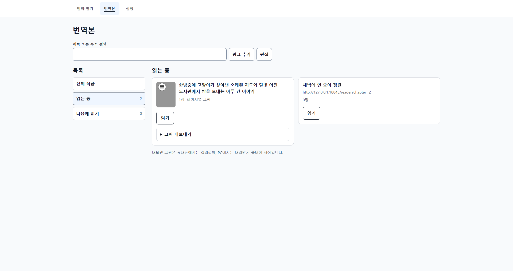
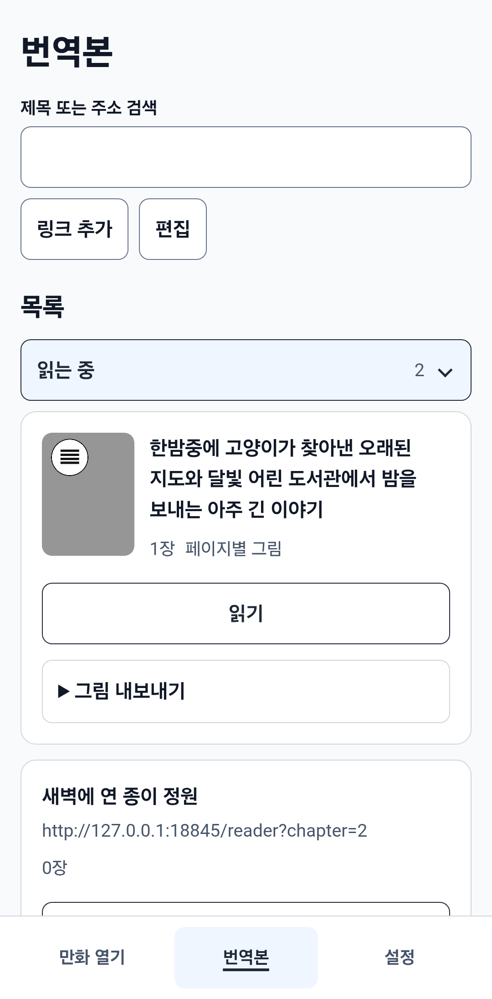

# Reader screens

The phone uses bottom navigation and expands the active list beneath its button. A Windows workspace at least 62rem wide uses top navigation and two library panes. Narrow desktop windows use the single-column layout. The [workspace design](../../DESIGN.md) records the layout sketches, type scale and the owner's Slate and blue palette.

## Open manga at `/`

Enter a page address, open a recent address, or import an image folder. Folder imports appear in the library as chapters. Address and import errors appear beside the source controls. The translation status shows the API key status, source language and Gemini request count. The browser build includes library and settings support and shows how to open sites in the installed app.

The reader toolbar holds the translation toggle and `앱으로 돌아가기`. In a Windows site reader, returning closes the reader window. On Android, it returns to the app screen that opened the site. The imported-chapter reader returns to the library.

## Library at `/library`

Search all titles or narrow the current list by title or address. Choose a saved list to see its titles in reading order. On Windows, lists stay on the left and titles appear on the right.

`링크 추가` saves an address with a title. Edit opens list and membership controls. A work can belong to several lists, and removing a membership or deleting a list keeps its saved work and pictures.

Read opens the saved site or imported chapter. On titles with pictures, `그림 내보내기` reveals PNG and WebP export options. The browser offers downloads for exported images, and the installed app reports where it saved the files.

The [verification record](../../e2e/receipts/reader-layouts/verification.txt) includes the viewport measurements and installed-app journeys.

## Settings at `/options`

Add, replace or delete the Gemini API key. A saved key shows its last four characters. Select Japanese or English as the source language for newly opened pages. A change that fails to save restores the previous language.
