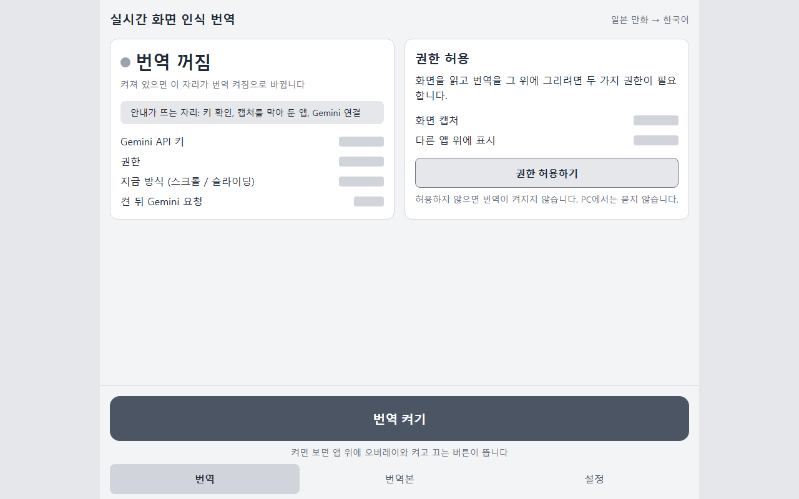
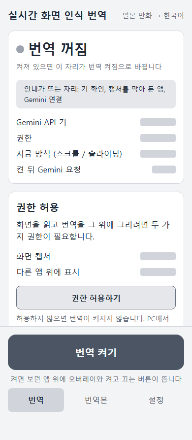
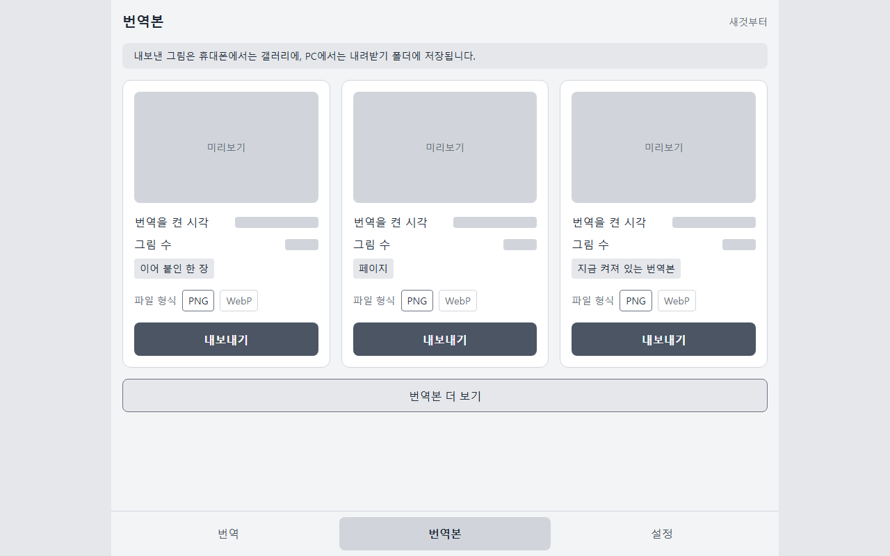
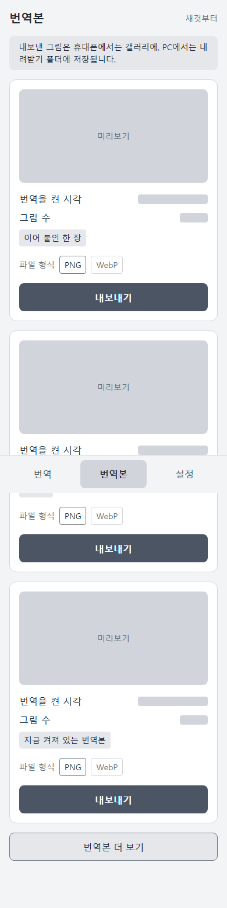
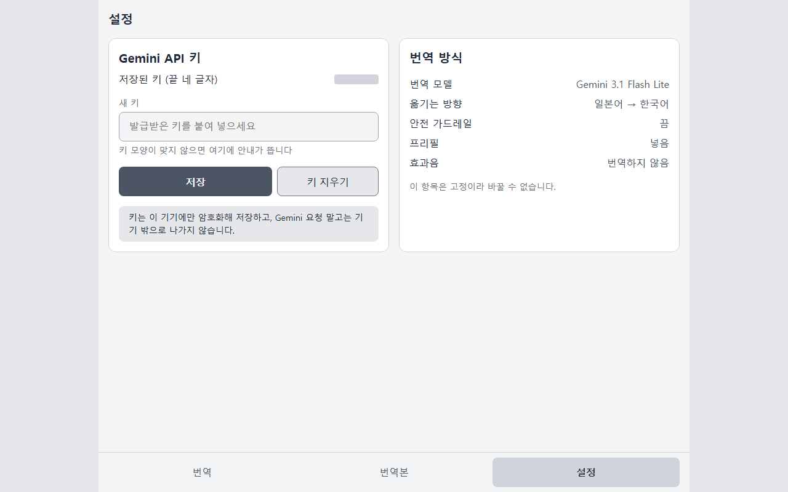
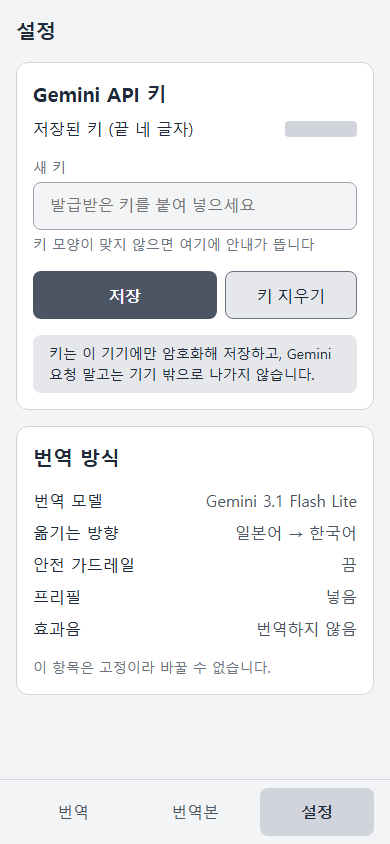

# 화면 설계 — realtime-screen-translator

> 첫 화면은 실시간 화면 인식 번역을 켜고 끄는 화면입니다.

## 첫 화면 S1 `/`

Since 2026-11-17 (the in-app reader, see `backend.md`), S1 opens a manga page by its address in the app's reader. The Korean is attached to the page pictures there, so S1 has no on/off switch and no permissions to ask. S1 shows the address field with recent addresses, plus a status card: key, source language with a link to S3, Gemini requests since the app opened, and any notice. The browser build says that only the installed app can open sites. The screenshots below are from before this change.

## 기능을 둔 자리

| 기능 | 주인이 고른 칸 | 놓인 화면 |
| --- | --- | --- |
| Open a manga page in the reader (`open-site`) | 늘 쓴다 | S1 |
| 번역 상태와 안내 보기 (`translation-status`) | 늘 쓴다 | S1 |
| Translation on/off, back to the app (`번역 켜짐/꺼짐`, `앱`) | 늘 쓴다 | reader toolbar, bottom left of the opened page |
| Gemini API 키 넣기 (`set-gemini-key`) | 드물게 쓴다 | S3 |
| Source language, Japanese or English (`set-source-lang`) | 드물게 쓴다 | S3 |
| 스크롤과 슬라이딩 트래킹 (`track-screen`) | 화면에 없다 | 없음 |
| 말풍선 위에 번역 띄우기 (`translate-balloons`) | 화면에 없다 | 없음 |
| 읽은 화면을 번역본에 담기 (`save-strips`) | 화면에 없다 | 없음 |
| 번역본 목록 보기 (`list-books`) | 가끔 쓴다 | S2 |
| 번역본 내보내기 (`export-book`) | 가끔 쓴다 | S2 |

## 다른 화면

### S2 `/library` — 기기에 저장된 번역본을 새것부터 훑어보고, 남기고 싶은 번역본을 골라 그림 파일로 내보내는 화면입니다.

Search by title or site address across the device library, or choose a named list to browse in reading order. In the installed app, Read opens the saved site or the app-owned chapter. Books whose original address is unavailable show their saved pictures and export controls.

Edit opens the link form and list controls. A work can belong to several lists. Removing a membership or deleting a list keeps the work, its images and its translations in the library.

### S3 `/options` — 자기 Gemini API 키를 넣거나 바꾸거나 지우는 설정 화면입니다.

S3 also holds the reader's source language (일본어 / 영어). A change that fails to save goes back to the previous choice.

## 색 배합 (하나를 고른다)

| id | 이름 | primary | surface | text | accent |
| --- | --- | --- | --- | --- | --- |
| C1 (고름) | 먹색 종이 | `#1f2937` | `#f8fafc` | `#111827` | `#2563eb` |
| C2 | 밤에 읽는 화면 | `#38bdf8` | `#0f172a` | `#e2e8f0` | `#fbbf24` |
| C3 | 말풍선 흰빛 | `#0f766e` | `#ffffff` | `#1c1917` | `#ea580c` |

화면마다의 상태, 백엔드 리뷰

- **S1.states** 비었을 때: Gemini API 키와 권한이 아직 없을 때입니다. 상태 칸마다 없음으로 표시되고, 안내 띠에 키를 먼저 넣어 달라는 글과 설정으로 가는 버튼이 보입니다. 켜기 버튼은 눌리지만 누르면 무엇이 빠졌는지 알려 줍니다. / 불러오는 중: 상태를 읽는 동안 상태 칸이 회색 띠로 보이고 켜기 버튼은 잠깁니다. 켜기나 끄기를 누른 직후에는 버튼 글이 켜는 중, 끄는 중으로 바뀝니다. / 오류: 키가 틀렸거나, 캡처를 막아 둔 앱이거나, Gemini에 닿지 않으면 안내 띠에 까닭과 할 일이 뜹니다. 권한을 거절했으면 왜 필요한지 설명과 함께 권한 허용하기 버튼이 다시 나옵니다. / 찼을 때: 번역이 켜져 있으면 큰 글씨가 번역 켜짐으로, 버튼이 번역 끄기로 바뀝니다. 지금 스크롤 방식인지 슬라이딩 방식인지와 켠 뒤 나간 Gemini 요청 횟수가 보이고, 권한 칸은 접힙니다.
- **S2.states** 비었을 때: 저장된 번역본이 아직 없습니다. 번역을 켜고 만화를 읽으면 여기에 쌓인다는 안내와 첫 화면으로 돌아가는 버튼이 보입니다. / 불러오는 중: 목록을 읽는 동안 번역본 칸 자리에 회색 상자가 세 개 놓입니다. 내보내는 동안에는 그 번역본의 버튼 글이 내보내는 중으로 바뀌고 다시 눌리지 않습니다. / 오류: 저장 공간이 모자라거나 갤러리에 쓸 권한이 없으면 그 번역본 칸 아래에 까닭이 뜨고 다시 내보내기 버튼이 나옵니다. 그림이 하나도 없는 번역본은 내보낼 것이 없다고 알려 줍니다. / 찼을 때: 번역본이 새것부터 놓이고, 번역본마다 미리보기와 켠 시각으로 지은 이름, 그림 수, 이어 붙인 한 장인지 페이지인지가 보입니다. 내보내기를 마치면 그림 몇 장이 어디에 저장됐는지 알려 줍니다.
- **S3.states** 비었을 때: 저장된 키가 없습니다. 입력 칸이 비어 있고, 키를 넣어야 번역을 켤 수 있다는 안내가 보입니다. 키 지우기 버튼은 잠깁니다. / 불러오는 중: 저장하는 동안 저장 버튼 글이 저장하는 중으로 바뀌고 입력 칸이 잠깁니다. / 오류: 키 모양이 맞지 않으면 입력 칸 아래에 다시 확인해 달라는 글이 뜨고, 넣은 글자는 그대로 남습니다. / 찼을 때: 키가 저장돼 있으면 끝 네 글자만 보이고 입력 칸은 비어 있습니다. 새 키를 넣어 바꾸거나 키 지우기로 지울 수 있습니다.

- 백엔드 리뷰: approve (`8092c37d8c88`), 발견 0개

